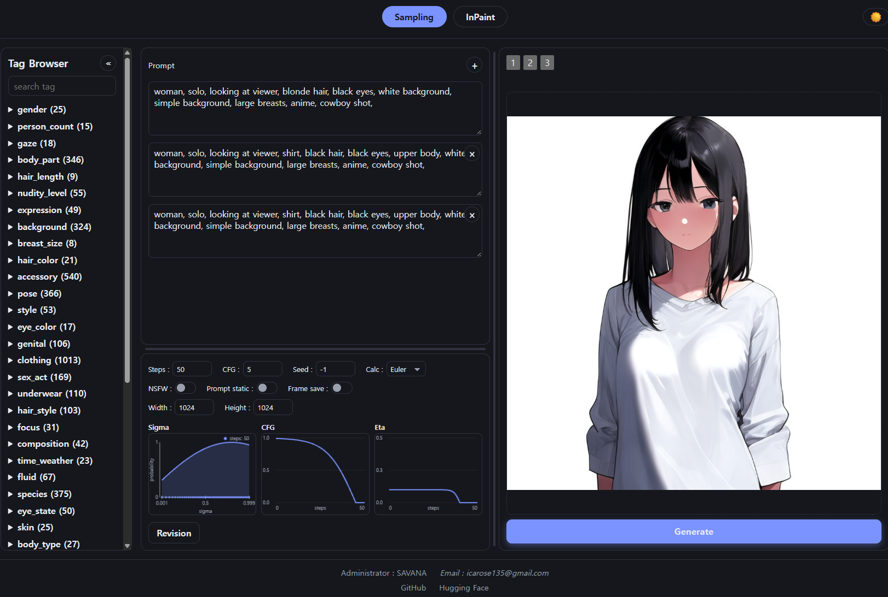
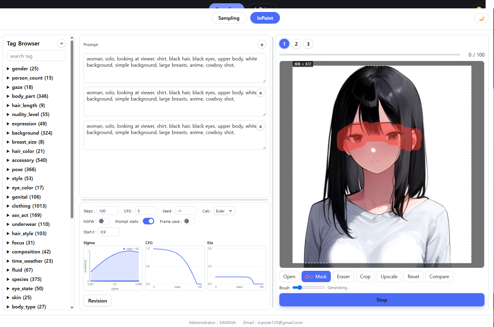
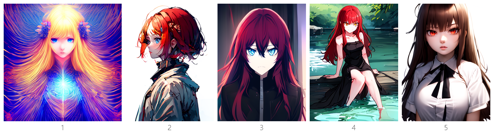
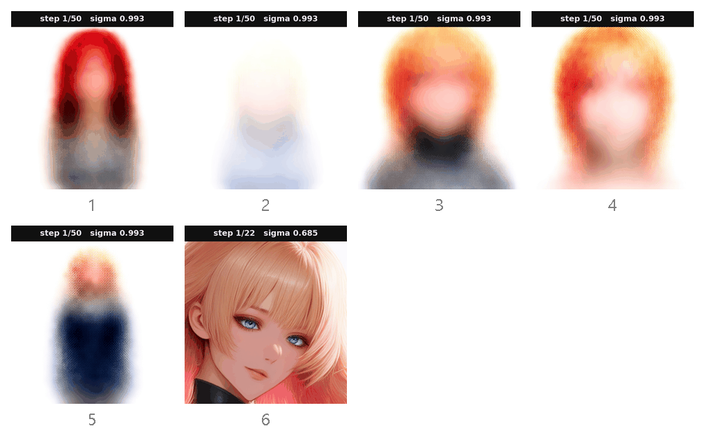

# Diffusion Text-to-Image

## UI Update

- **Multi-prompt** support
- **Custom schedulers**
  - Sigma scheduler (CDF-based)
  - CFG scheduler
  - Eta scheduler
- **Click-button revision**

## Screenshots

### Sampling


### Inpainting


[Update](CHANGELOG.md) · [Train State](docs/training.md) · [Architecture](docs/architecture.md) · [UI](docs/ui.md)





## Installation
```bash
git clone https://github.com/FREEANIMA/DiffusionSampling.git
cd DiffusionSampling
python3 -m venv .venv
source .venv/bin/activate
python -m pip install -r requirements.txt
python main.py
```

## External Models

- **Autoencoder:** DC-AE f32c32 (32× compression, 32 latent channels)
- **Text Encoder:** T5-Large

## Model

- **Architecture:** MMDiT 
- **Parameters:** 4B
- **Task:** Text-to-Image
- **Weights:** [Hugging Face](https://huggingface.co/honghong3/VER9) (currently being updated to VER10)

Please check the version in [version.py](version.py).

---

### Training Stages

| Stage | Description | Steps | Patch Size | max H x W |
|:---:|---|---:|:---:|:---:|
| Stage 1 | Pre-training | 600K | 2 | 1024 x 1024 |
| Stage 2 | Fine-tuning  | 100k | 1 | 1024 x 1024 |
| Stage 3 | Fine-tuning  | 300K | 1 | 2048 x 2048 |

---

- **GITHUB link** https://github.com/FREEANIMA/DiffusionSampling.git
