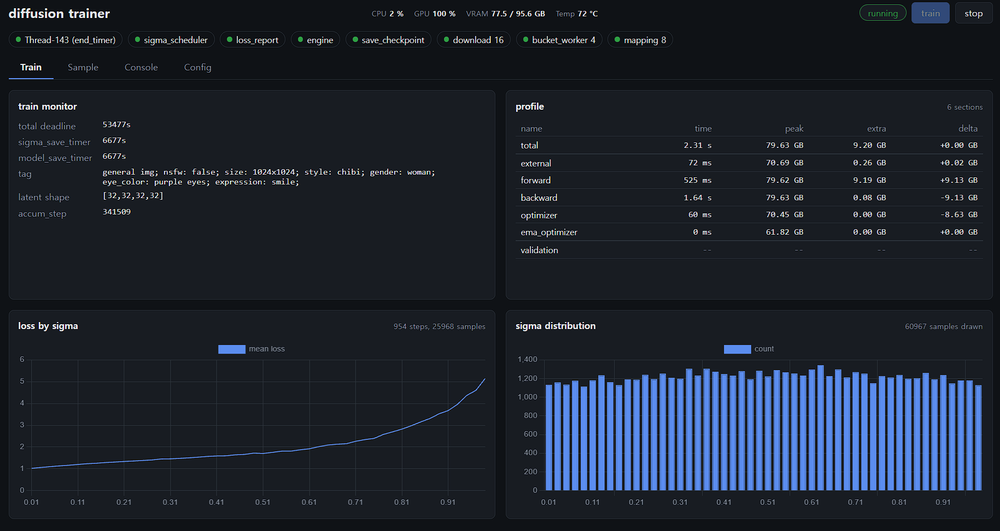
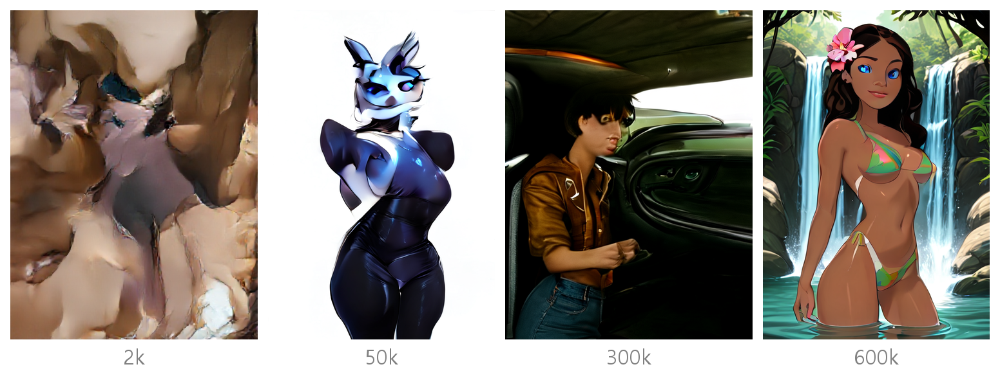
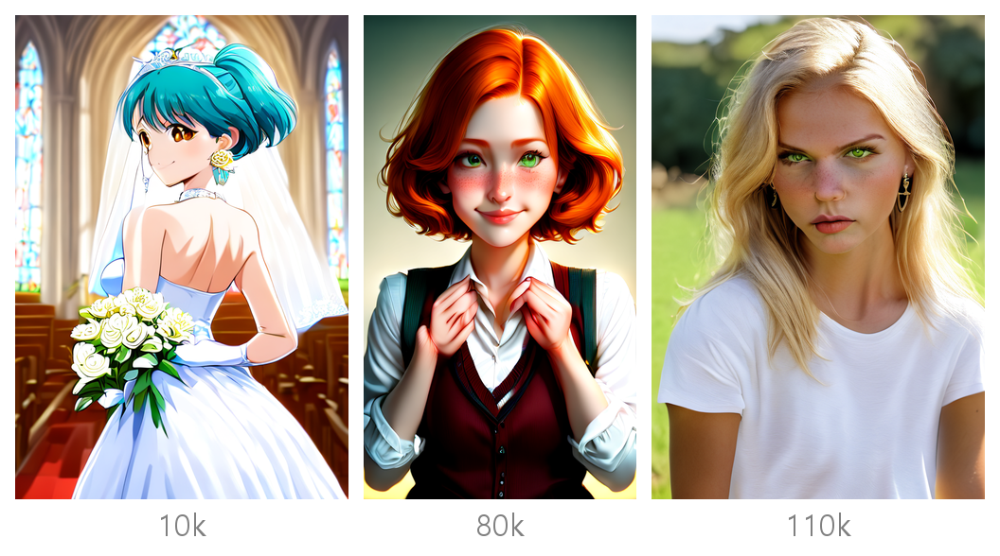

## Train Environment

- **Framework:** PyTorch (no custom CUDA kernels)
- **GPU:** NVIDIA RTX PRO 6000 (96GB VRAM) x 1
- **Platform:** Google Colab
- **Batch Size:** Micro-batch 4 × Gradient Accumulation 8 = Effective Batch 32

- **Training Speed:** ~2.3 s / optimizer step
- **Max Resolution:** 1024 × 1024
- **Dataset:** 2M images
- **Objective:** Flow Matching
- **Precision:** BF16
- **Optimizer:** AdamW
- **Learning Rate:** 1e-4 ~ 5e~5
- **EMA:** Enabled

## Train UI

### Loss by Noise Level

| Noise Level | Average Loss |
|:---:|---:|
| 1.0 – 0.9 | 4.0 ~ 4.3 |
| 0.9 – 0.8 | 2.9 ~ 3.1 |
| 0.8 – 0.7 | 2.4 ~ 2.6 |
| 0.7 – 0.6 | 2.0 ~ 2.1 |
| 0.6 – 0.5 | 1.8 ~ 1.9 |
| 0.5 – 0.4 | 1.6 ~ 1.7 |
| 0.4 – 0.3 | 1.3 ~ 1.6 |
| 0.3 – 0.2 | 1.2 ~ 1.4 |
| 0.2 – 0.1 | 1.0 ~ 1.1 |

## Generation Results

### Patch Size 2 + DC-AE f32c32

- **Issue:** Facial features, particularly the eyes, tend to collapse or become distorted.
- **Observation:** Limited spatial detail makes accurate reconstruction of fine facial features challenging.

### Patch Size 1 + DC-AE f32c32

- **Fine-tuning Result:** Fine-tuning with patch size 1 improved facial feature reconstruction.
- **Improvement:** Eye and facial distortions were partially resolved, with better preservation of fine details.